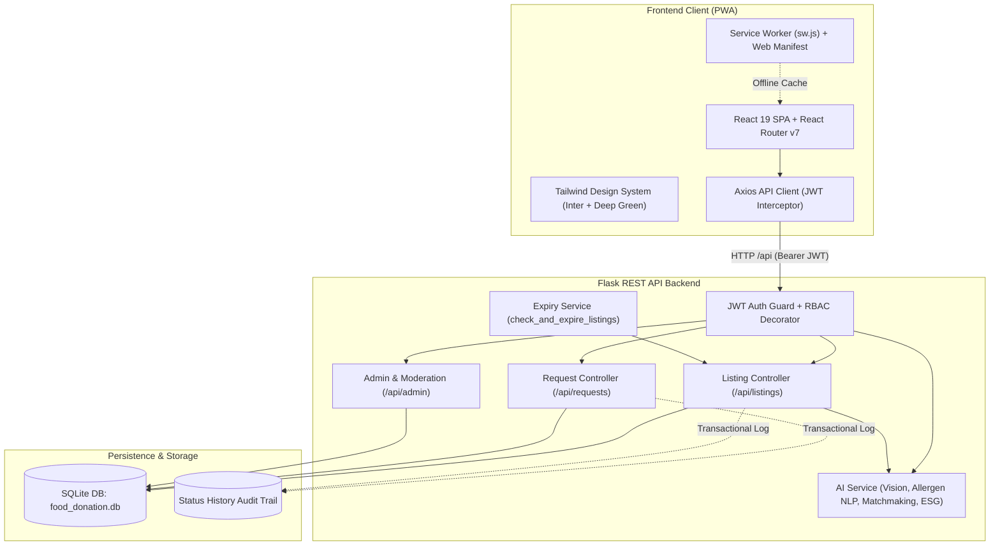
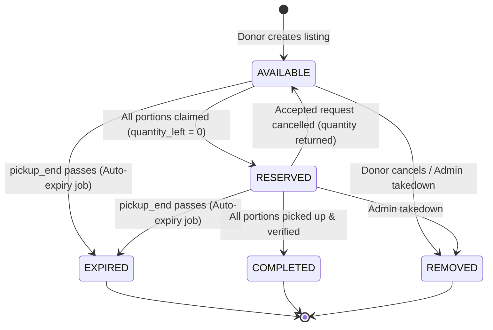
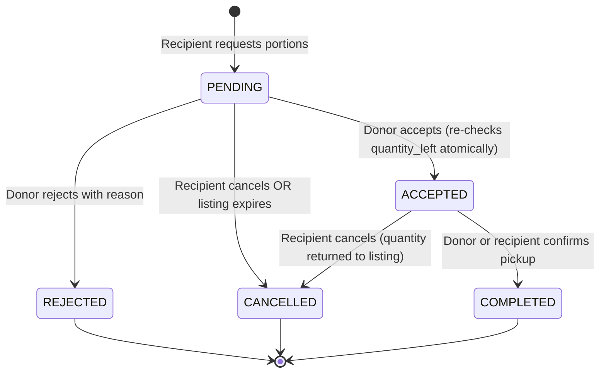

# FoodShare — Food Donation Platform (PWA)

A responsive Progressive Web Application (PWA) built for surplus food rescue, connecting commercial food donors (restaurants, bakeries, caterers, hotels) with recipient organizations (soup kitchens, shelters, food banks).

> [!WARNING]
> **Food Safety & Platform Disclaimer**  
> **Demonstration Environment Only.** This software is an architectural prototype and demonstration platform. It is **NOT** a food safety verification system, health department inspection service, or certified cold-chain monitoring system. All accounts and listings are fictitious. In real-world deployment, food donors and recipient organizations remain solely responsible for local food code compliance, allergens, and safe temperature handling.

---

## 1. System Architecture

### High-Level Component Diagram



---

### Entity Lifecycles & State Transitions

#### Listing Lifecycle


#### Request Lifecycle


---

## 2. Core Business Rules Implemented

1. **Transactional Quantity Locking & Concurrency Protection:**
   - Accepting a request locks the listing row (`with_for_update()`) and atomically verifies that `quantity_left >= request.quantity`.
   - If two charities submit requests for overlapping surplus portions, the first acceptance locks the inventory. The second acceptance attempt is rejected with **HTTP 409 Conflict** (`"Double booking prevented"`).
2. **Cancellation Restores Inventory:**
   - When a charity cancels an `ACCEPTED` pickup, its requested quantity is returned to `listing.quantity_left`.
   - If the listing was previously locked as `RESERVED`, it automatically transitions back to `AVAILABLE`.
3. **Automated Expiry & Request Cascade:**
   - Listings past `pickup_end` are automatically transitioned to `EXPIRED` by the expiry background service.
   - Any remaining `PENDING` requests for expired listings are automatically marked `CANCELLED`.
4. **Complete Audit Trail:**
   - Every state transition across listings and requests is permanently logged in `status_history` with actor ID, timestamp, prior state, new state, and narrative reason.
5. **Role-Based Route Protection (RBAC):**
   - Every route in the Flask API is strictly protected by `@role_required("donor")`, `@role_required("recipient")`, or `@role_required("admin")`.

---

## 3. Hackathon AI Innovations

1. **AI Food Vision & Smart Listing Drafter ("Snap & List"):**
   - Donors can upload a food photo or select instant kitchen presets (*"Warm Buffet Trays"*, *"Artisan Bakery"*, *"Catering Boxed Meals"*).
   - Automatically populates title, portions, units, safe storage advice, and regulatory pickup windows.
2. **Automated Allergen & Dietary Risk Screening ("AI SafeGuard"):**
   - Detects the 9 major allergens (Gluten, Dairy, Eggs, Nuts, Soy, Fish, Shellfish, Sesame) and dietary attributes (Vegan, Vegetarian, Halal).
   - Renders color-coded safety warnings on recipient browse cards and detail modals.
3. **Intelligent Charity Matchmaking & Priority Dispatch:**
   - Multi-factor algorithmic scoring matches listings to nearby charities based on capacity fit, transit distance, vehicle equipment (refrigerated van), and past pickup reliability.
   - Donors can inspect top matches with percentage fit and 1-click dispatch alerts.
4. **Green Impact Hub — EPA WARM ESG Carbon Ledger:**
   - Converts rescued food portions into verified environmental metrics: $CO_2e$ greenhouse gas emissions prevented, agricultural water conserved, and passenger car travel eliminated.
   - Includes printable CSR compliance certificates for corporate food donors.

---

## 4. Demo Credentials

All demo accounts share the password: `demo1234`

| Role | Account Email | Organization | Type |
|---|---|---|---|
| **Admin** | `admin@demo.local` | Platform Administration | Platform Moderator |
| **Donor** | `donor@demo.local` | Green Leaf Restaurant | Mediterranean Restaurant |
| **Donor** | `donor2@demo.local` | City Catering Co. | Corporate Event Catering |
| **Donor** | `donor3@demo.local` | Sunrise Bakery | Artisan Bakery |
| **Recipient** | `recipient@demo.local` | Hope Community Kitchen | Soup Kitchen & Shelter |
| **Recipient** | `recipient2@demo.local` | Springfield Food Bank | Regional Food Bank |
| **Recipient** | `recipient3@demo.local` | Shelter First Network | Emergency Housing Shelter |

> [!TIP]
> The sign-in page (`/login`) includes **1-click quick-fill buttons** for Donor, Recipient, and Admin accounts.

---

## 5. Setup & Running Locally

### Prerequisites
- **Python 3.10+**
- **Node.js 18+ & npm**

### 1. Backend Setup
```bash
cd backend

# Create and activate virtual environment
# Windows:
python -m venv venv
.\venv\Scripts\activate
# Linux/macOS:
# python3 -m venv venv && source venv/bin/activate

# Install dependencies
pip install -r requirements.txt

# Seed demonstration data (10 listings across 3 donors, 7 users, sample requests)
python seed.py

# Run development server (runs on http://localhost:5000)
python run.py
```

### 2. Frontend Setup
```bash
cd frontend

# Install npm packages
npm install

# Start Vite dev server (runs on http://localhost:5173 with proxy to port 5000)
npm run dev

# Or build production PWA bundle
npm run build
```

---

## 6. Environment Variables

### Backend (`backend/.env`)
| Variable | Default Value | Description |
|---|---|---|
| `SECRET_KEY` | `dev-secret-key-change-in-production` | Flask session secret |
| `DATABASE_URL` | `sqlite:///food_donation.db` | SQLAlchemy database URI |
| `JWT_SECRET_KEY` | `jwt-secret-key-change-in-production` | Secret used to sign access tokens |
| `CORS_ORIGINS` | `http://localhost:5173` | Allowed frontend origin for CORS |

### Frontend (`frontend/.env`)
| Variable | Default Value | Description |
|---|---|---|
| `VITE_API_URL` | `http://localhost:5000/api` | API backend base URL |

---

## 7. Running the Automated Test Suite

A comprehensive test suite verifies core business logic:
- Double-booking prevention with concurrent competing requests.
- Cancellation restoring inventory and reverting `RESERVED` $\rightarrow$ `AVAILABLE`.
- Donor cancellation auto-cancelling pending requests.
- Auto-expiry service expiring past listings and cancelling pending requests.
- Role-based access control blocking unauthorized actors with HTTP 401 and 403.

```bash
cd backend
python tests/run_all.py
```

---

## 8. Project Limitations & Non-Goals

1. **Food Safety Certification:** The platform does not inspect, test, or certify food safety or microbial quality.
2. **Payment Processing:** No money changes hands; all food is donated at zero cost.
3. **Cold-Chain Hardware:** Real-time IoT temperature sensors are simulated via manual timestamps.
4. **Offline Sync Queue:** PWA caches app shell and static resources; write actions require network connectivity.

---

## 9. Implementation Checklist

- [x] **Phase 1: Foundation & Design System** (DB models, JWT auth, RBAC, seed script, design components, PWA setup)
- [x] **Phase 2: Donor Workflows** (Profile, create/edit/cancel listing, my listings, dashboard)
- [x] **Phase 3: Recipient Workflows** (Browse, search, filter, listing detail, request/cancel)
- [x] **Phase 4: Request Lifecycle & Locking** (Atomic acceptance, quantity locking, cancellation quantity return, auto-expiry)
- [x] **Phase 5: Admin & Moderation** (Moderation table, report handling, listing removal)
- [x] **Phase 6: Verification & Automated Tests** (Concurrency locks, cancellation returns, expiry job, architecture diagrams)
- [x] **Phase 7: Final Polish** (Reactive pickup countdown tickers, semantic dot status badges, public live meals redistributed impact counter)
- [x] **Hackathon AI Suite** (AI Food Vision & Drafter, Allergen Screening, Smart Charity Matchmaker & Dispatch, EPA WARM ESG Carbon Ledger)
